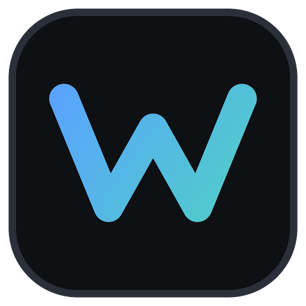

<p align="center">
  
</p>

<h1 align="center">Wercode</h1>

<p align="center">
  <b>The terminal-first code editor.</b><br>
  Your terminal in the middle, with files, git and code checks around it.<br>
  Native, written in Rust. Opens in under a second. No browser engine inside.
</p>

<p align="center">
  <a href="https://github.com/Werroks/Wercode/releases/latest"></a>
  
  
  <a href="#license"></a>
</p>

<p align="center">
  
</p>

---

More and more code gets written by an agent running in a terminal: Claude Code,
Codex, Aider, Gemini CLI. The editors we use were built for typing every line
yourself, so the terminal sits in a strip at the bottom and the agent's work
shows up in a window that was never meant for it.

**Wercode turns that around.** The terminal takes the middle of the window, with
tabs and splits that come back after a restart. Next to it: the files of your
project with their git status, a git panel with a commit graph, an editor for
the edits you still make by hand, and the errors and warnings of your code.
Everything opens at once, because there is no Chromium underneath, just Rust
drawing on your GPU.

## Why not just VS Code or Cursor?

They are good editors. But:

- **They are web pages in a box.** VS Code and Cursor run on Electron: a copy of
  the Chromium browser and Node.js behind every window. Wercode is a native
  program built on [GPUI](https://www.gpui.rs/), the GPU-rendered UI framework
  behind the Zed editor. On our Windows 11 test machine its window is up in
  0.3 s (0.8 s on a cold start), using about 70 MB of RAM with a project open.
- **The terminal is an afterthought.** In both it is a panel under the editor.
  In Wercode it is the main stage: tabs, splits, find in output, clickable paths
  and links, each terminal's folder and shell restored next time.
- **Cursor's AI needs an account and, past a free tier, a subscription,** and
  it sits in the middle of everything. Wercode has no AI built in, on purpose:
  run whichever agent you like in the terminal. No account, no sign-in. Wercode itself sends
  nothing anywhere except the update check, which you can turn off.
- **A good VS Code setup is a pile of extensions,** and each one adds to the
  start-up time. In Wercode the essentials are built in.

|  | **Wercode** | VS Code | Cursor |
| --- | --- | --- | --- |
| Built with | Rust, GPUI (native) | Electron | Electron (VS Code fork) |
| Terminal | in the centre, tabs and splits | bottom panel | bottom panel |
| AI | any CLI agent, your choice | Copilot | built in, paid plans |
| Account needed | no | no | for its AI features |
| Windows installer¹ | **10.5 MB** | 286 MB | 208 MB |
| Open source | yes, MIT / Apache-2.0 | core is MIT, the build is not | no |

<sub>¹ Sizes of the Windows installers on 15 November 2026: Wercode 0.2.0, VS Code 1.146, Cursor 3.30.</sub>

**When to stay with VS Code:** you depend on its extensions, a debugger, remote
development or notebooks. Wercode does not do these, and is not trying to be a
smaller VS Code.

## What is inside

**Agents in the terminal**
- Claude Code and Codex work right in the terminal, the way they do in Cursor: **Shift+Enter**
  (or Ctrl+Enter) starts a new line of your message instead of sending it, on Windows with any
  keyboard layout, on macOS and on Linux
- **Pasting a screenshot** (Ctrl+V on Windows, Cmd+V on macOS, Ctrl+Shift+V on Linux) saves it
  and hands the agent its path, which Claude Code and Codex attach as `[Image #1]`. Image files
  dragged onto the terminal work the same way

**Terminal**
- Your own shell: PowerShell, cmd, Git Bash, WSL, bash, zsh, fish (found automatically)
- Tabs you can rename and drag; up to four splits per tab
- Find in the output, Ctrl+click on links and on `file:line` from compiler output
- Tabs, splits and each terminal's folder come back after a restart
- Tasks: the scripts of `package.json`, Cargo and Go commands, `Makefile` targets and `justfile`
  recipes in one list (Ctrl+Shift+X); the chosen one runs in a new terminal tab

**Files and editor**
- File tree with git status colours, `.gitignore` respected, follows the disk live
- Go to any file by a few letters of its name, search and replace across the whole project
- Built-in editor with syntax colours for 20 languages, find and replace, undo
- Notices when an agent changes an open file and reloads it
- Marks next to the line numbers show what changed since the last commit; the status bar
  says who last changed the line under the cursor, and when

**Git**
- Stage, unstage, commit, discard; push, pull and fetch
- Commit graph with branches and tags; click a commit to see what it changed
- Branch, commits to push and pull, and changes in the status bar; switch, create and delete
  branches, and check out the ones that are only on the remote

**Code checks**
- Errors and warnings underlined as you type, with the message on hover
- A Problems panel with everything the checkers found in the project
- Rest the pointer on a name for its type and documentation; F12 or Ctrl+click goes to its definition
- Completion as you type (or Ctrl+Space), and formatting when a file is saved if you turn it on
- Uses the language servers already on your computer (see below)

**Everything else**
- Several windows at once, each with its own project (Ctrl+Shift+N or the button in the title bar)
- Command palette (Ctrl+Shift+P); every shortcut can be changed
- Five colour schemes; interface in English, Russian, German, Spanish and Chinese
- Updates itself in the background

## Download

Get the latest version from the **[Releases page](https://github.com/Werroks/Wercode/releases/latest)**.

| System | File | Notes |
| --- | --- | --- |
| Windows 10 and 11 | `Wercode-Setup-<version>-x64.exe` | Installs for your user, no admin rights. Not signed yet: if SmartScreen complains, click **More info → Run anyway**. |
| macOS 11+ (Apple silicon and Intel) | `Wercode-<version>-macos.dmg` | Not notarized yet: open it once, then **System Settings → Privacy & Security → Open Anyway**. |
| Linux x86-64 | `Wercode-<version>-linux-x64.tar.gz` | Unpack and run `./install.sh`: it puts `wercode` in `~/.local/bin` and adds a menu entry. |

Then open a folder from the welcome screen, or from a terminal:

```sh
wercode path/to/project
```

## Code checks (linters)

Wercode talks to **language servers**, the same programs VS Code and Zed use
for errors, warnings and lint rules, for what a name means and for where it
is defined. It does not bundle them: it finds the ones
installed on your computer and starts them when you open a file of their
language. If one is missing, the status bar says so and an **Install** button
runs the command below in a terminal tab, where you can watch it.

| Language | Server | Install |
| --- | --- | --- |
| Rust | rust-analyzer (with `cargo check` on save) | `rustup component add rust-analyzer` |
| TypeScript, JavaScript | typescript-language-server | `npm install -g typescript typescript-language-server` |
| Python | basedpyright, pyright or pylsp; also `ruff` if installed | `npm install -g pyright` |
| Go | gopls | `go install golang.org/x/tools/gopls@latest` |
| C, C++ | clangd | `winget install LLVM.LLVM` / `brew install llvm` / `apt install clangd` |
| JSON, CSS, HTML | vscode-langservers-extracted | `npm install -g vscode-langservers-extracted` |
| YAML | yaml-language-server | `npm install -g yaml-language-server` |
| Shell | bash-language-server | `npm install -g bash-language-server` |
| TOML | taplo | `cargo install taplo-cli --locked --features lsp` |
| Ruby | ruby-lsp | `gem install ruby-lsp` |

Checking can be turned off in Settings → **Check code**. **Format on save**, next
to it, lets the server lay the code out each time you save (for Rust that is
`rustfmt`: `rustup component add rustfmt`).

## Keyboard

Plain Ctrl keys belong to your shell, so Wercode's own shortcuts use Ctrl+Shift.
All of them can be changed in the `[keys]` table of `settings.toml`.

| Shortcut | Does |
| --- | --- |
| Ctrl+Shift+P | Command palette |
| Ctrl+Shift+K | Go to file |
| Ctrl+Shift+F | Find in files |
| Ctrl+Shift+G | Git panel |
| Ctrl+Shift+M | Problems |
| Ctrl+Shift+B | Show or hide the side panel |
| Shift+Enter or Ctrl+Enter | New line in the prompt of Claude Code, Codex or PowerShell |
| Ctrl+V (Cmd+V on macOS, Ctrl+Shift+V on Linux) | Paste text, or a screenshot as an image for the agent |
| Ctrl+Shift+N | New window |
| Ctrl+Shift+T | New terminal tab |
| Ctrl+Shift+D / Ctrl+Shift+E | Split right / split down |
| Ctrl+Shift+S | Find in terminal output |
| Ctrl+Shift+X / Ctrl+Shift+L | Run a task / run the last task again |
| Ctrl+Shift+J | Show or hide the terminal (terminal-below layout) |
| Ctrl+Shift+Enter | Commit |
| Ctrl+Shift+Up / Down | Push / pull |
| Ctrl+S | Save (in the editor) |
| F12 or Ctrl+click | Go to definition (in the editor) |
| Ctrl+Space | Completion (in the editor) |
| Ctrl+Alt+arrows | Go to the terminal on that side of a split |

## Build from source

You need a recent stable [Rust](https://rustup.rs) and:

- **Windows:** Visual Studio Build Tools with the C++ workload
- **macOS:** Xcode command line tools (`xcode-select --install`)
- **Linux (Debian, Ubuntu):**
  `sudo apt install libxkbcommon-dev libxkbcommon-x11-dev libwayland-dev libxcb1-dev libx11-dev libx11-xcb-dev libfontconfig1-dev libfreetype6-dev libasound2-dev libssl-dev libvulkan-dev pkg-config`

```sh
git clone https://github.com/Werroks/Wercode
cd Wercode
cargo run --release -- path/to/project
```

The first build compiles the UI framework and takes a while; later ones take
seconds. `cargo test` runs the tests, including ones that open real windows
and shells without showing them.

## Roadmap

- Editor splits, image preview, your own colour schemes
- Signed Windows and macOS builds

Ideas and bug reports are welcome in [Issues](https://github.com/Werroks/Wercode/issues).

## Support Wercode

Wercode is free and open source, and it stays that way. If it saves you time and you
want to help it grow, you can send **USDT on the TRON network (TRC-20)** to:

```
TVb5SbxLo7kWetAw3Y7n4bdArfsfD1wLRX
```

Send only USDT on TRC-20 to this address; coins sent on another network are lost.
The same address is in Wercode under Settings → **Support Wercode**, with a button to copy it.
Thank you!

## License

Wercode is free and open source, under your choice of the
[MIT License](LICENSE-MIT) or the [Apache License 2.0](LICENSE-APACHE).
